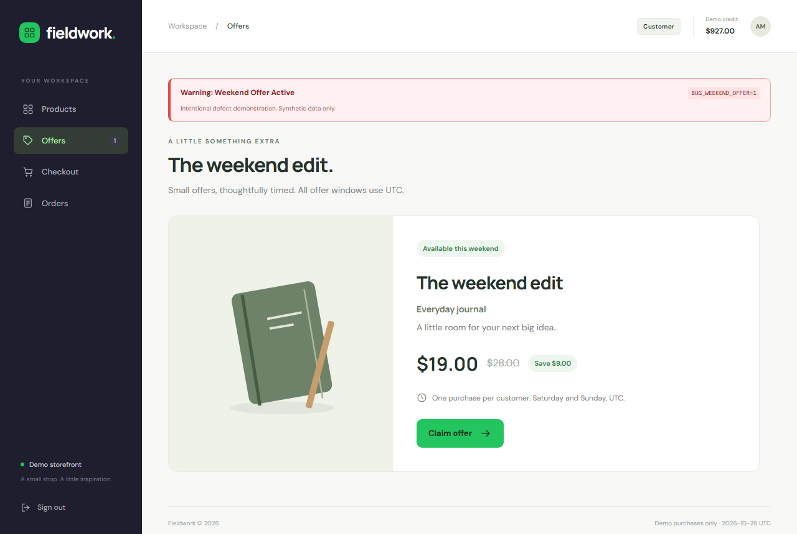
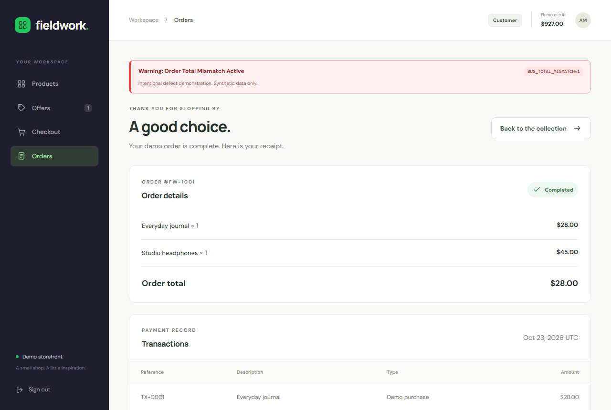
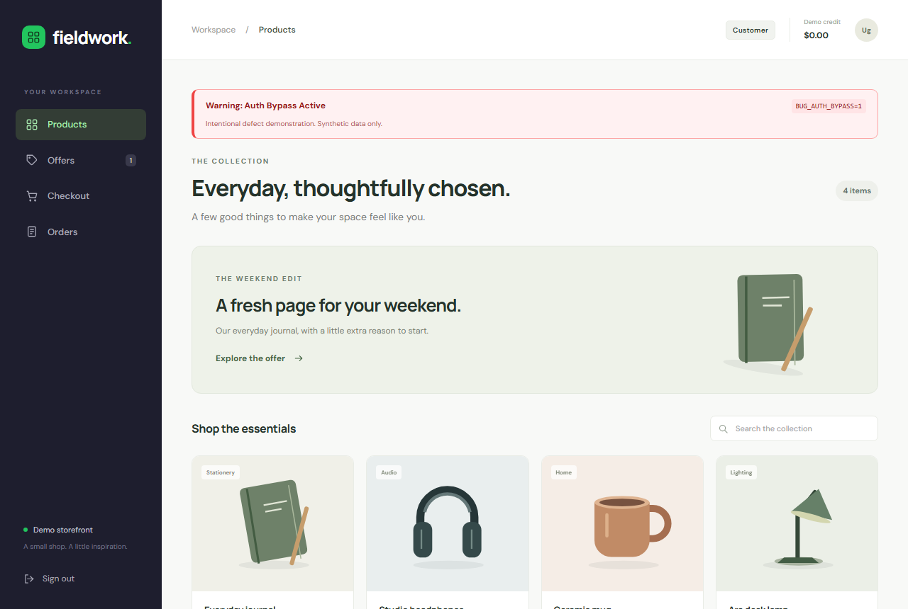
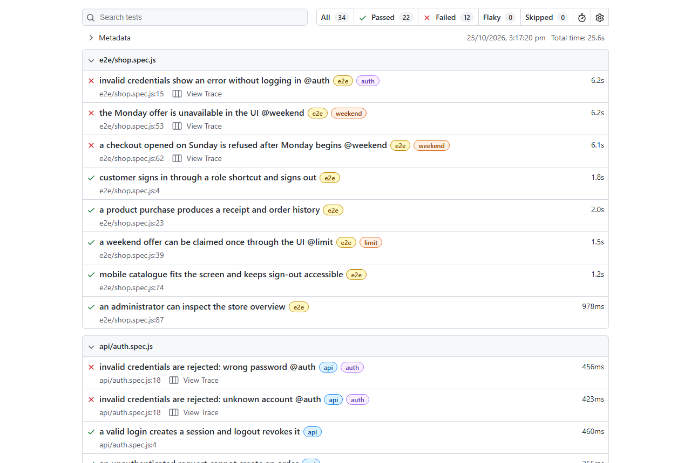

# Case studies

Three defects, each a synthetic reconstruction of something that breaks in real systems. Every
screenshot below was captured from this application with the named flag enabled, against a disposable
database. Live reports: [correct build](https://akshat14092003.github.io/release-verification-lab/green/index.html)
and [defect demonstration](https://akshat14092003.github.io/release-verification-lab/red/index.html).

All flags default to 0. A seeded defect is a demonstration, not a production requirement or a
security certification.

---

## 1. The offer that outlived the weekend

**Flag:** `BUG_WEEKEND_OFFER=1` - the server's UTC weekday guard is omitted from the offer listing and
from checkout. The guard is a single server-side condition, which is exactly why it is easy to lose in
a refactor and impossible to see from the client.

The screenshot is Monday 2026-10-26 UTC. The offer still advertises itself as available and the
claim button still works.

**How the suite catches it - 5 failures:**

| Layer | Check |
| --- | --- |
| API | `UTC offer window: Friday before opening @weekend` |
| API | `UTC offer window: Monday at closing @weekend` |
| Browser | `the Monday offer is unavailable in the UI @weekend` |
| Browser | `a checkout opened on Sunday is refused after Monday begins @weekend` |
| Database | `a rejected weekday purchase leaves orders, items, and ledger unchanged @weekend` |

The boundary checks matter more than the midweek one: Friday 23:59 and Monday 00:00 UTC are where an
off-by-one guard actually fails. The Sunday-to-Monday check covers a session that was legitimately
opened inside the window and submitted outside it, which no page-load check would catch.

Tests never depend on the real date. The server clock is injected, so a Monday is a Monday in CI in
any timezone. Valid weekend purchases still pass with the flag on, which is what distinguishes a
targeted failure from a broken suite.

---

## 2. A purchase cap bypassed through the API

**Flag:** `BUG_NO_LIMIT=1` - only the purchase-time cap is removed. The listing and the quote still
report the offer as claimed, so the interface looks correct and a UI-only suite sees nothing wrong.

**How the suite catches it - 1 failure:**

| Layer | Check |
| --- | --- |
| API | `a direct second purchase of the same offer is refused @limit` |

The browser check `a weekend offer can be claimed once through the UI @limit` keeps passing. That pair
is the point of the case study: the control that still passes tells you the defect is in enforcement,
not in display, and a suite that only drives the browser would have shipped it.

The failing check attaches the successful second-purchase response, so the evidence is the server's
own 201, not a test assertion message.

---

## 3. The displayed total that disagreed with the ledger

**Flag:** `BUG_TOTAL_MISMATCH=1` - the receipt reuses the first order line as the order total. Stored
data stays correct; only the rendered figure lies, which is the hardest class of money bug to notice.

The seeded order has two lines, $28 and $45. The page lists both and then reports $28.00 as the order
total. The stored order, the line-item sum, and the ledger all still say $73.

**How the suite catches it - 1 failure:**

| Layer | Check |
| --- | --- |
| Database | `the two-item seed receipt matches independent ledger and item sums @total` |

The check recomputes the total with read-only SQL over the stored lines and ledger entries, then
compares it with the amount actually rendered. It never reads the displayed figure back into the
expectation, which is the only way this bug is catchable. A single-line receipt stays correct with the
flag on, so the failure points at multi-line reconciliation specifically.

---

## Bonus: the authentication bypass

**Flag:** `BUG_AUTH_BYPASS=1` - credential verification is skipped and unknown emails are provisioned
as zero-credit guests. Below, `not-a-real-user@example.test` with a wrong password is signed in, with
$0.00 credit.

Five checks fail: two API credential checks, one browser check, and the two security probes that send
SQL-like text into the login form. Those two probes fail here because *any* credentials now
authenticate - it is an authentication bypass, not SQL injection. The parser is never reached, and the
distinction is kept explicit so the demonstration is not oversold.

---

## Failing for the right reason

Every red run must produce exactly this set of twelve failures with twenty-two controls still passing.
The harness matches failing-test identities, requires a fresh per-run report token, and rejects stale
reports, extra failures, skips, retries, timeouts, and non-assertion setup errors - so a broken
environment cannot be mistaken for successful detection.

Measured ten consecutive times: the same twelve failures every run. See
[repeatability](REPEATABILITY.md), [defect results](DEFECT-RESULTS.md), and
[defect demonstrations](DEFECT-DEMONSTRATIONS.md).
